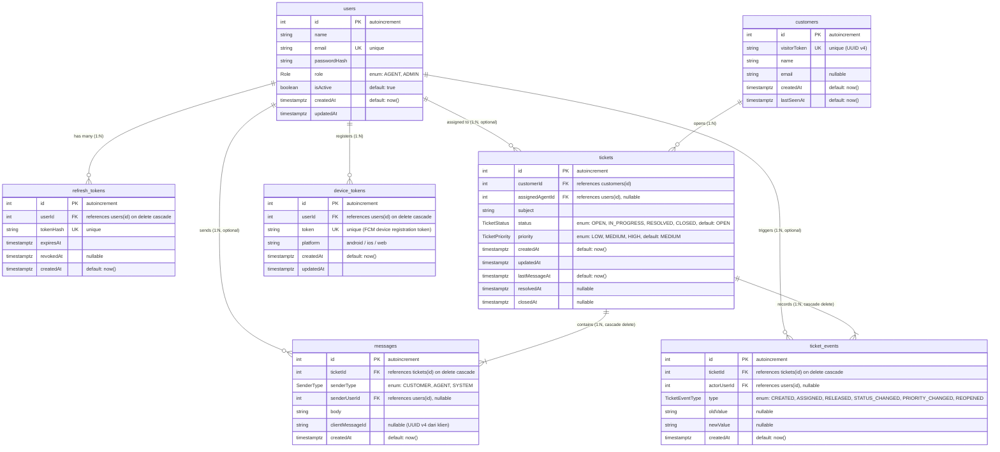

# Entity Relationship Diagram (ERD) — Helpdesk System

Dokumen ini memuat Entity Relationship Diagram (ERD) yang diturunkan **langsung** dari skema Prisma (`backend/prisma/schema.prisma`) tanpa modifikasi atau penambahan kolom fiktif.

---

## 1. Diagram ERD (Mermaid)

---

## 2. Keterangan Enum

| Enum | Nilai yang Diizinkan | Deskripsi Singkat |
|---|---|---|
| `Role` | `AGENT`, `ADMIN` | Otorisasi hak akses internal (Admin mengelola user dan assign tiket). |
| `TicketStatus` | `OPEN`, `IN_PROGRESS`, `RESOLVED`, `CLOSED` | Siklus hidup tiket layanan pelanggan. |
| `TicketPriority` | `LOW`, `MEDIUM`, `HIGH` | Prioritas penanganan keluhan. Default: `MEDIUM`. |
| `SenderType` | `CUSTOMER`, `AGENT`, `SYSTEM` | Identifikasi asal pengirim pesan dalam thread tiket. |
| `TicketEventType` | `CREATED`, `ASSIGNED`, `RELEASED`, `STATUS_CHANGED`, `PRIORITY_CHANGED`, `REOPENED` | Jenis riwayat audit trail tiket. |

---

## 3. Indeks & Batasan Unik Kunci (Indexes & Constraints)

1. **Idempotensi Pesan**:
   - `@@unique([ticketId, clientMessageId])` pada tabel `messages`.
   - Menjamin bahwa pesan yang dikirim ulang akibat timeout socket / retry koneksi tidak akan pernah terduplikasi di database.
   - Kolom `clientMessageId` bernilai `NULL` untuk pesan `SYSTEM` (PostgreSQL mengizinkan multiple `NULL` pada unique index).
2. **Performa Filter & Antrean**:
   - `@@index([status, assignedAgentId])` pada tabel `tickets`: Mengoptimalkan filter tab antrean (`OPEN` tanpa agen) dan "Tiket Saya" (`assignedAgentId = currentUserId`).
   - `@@index([customerId, createdAt])` pada tabel `tickets`: Pencarian tiket aktif milik visitor/customer.
   - `@@index([lastMessageAt])` pada tabel `tickets`: Pengurutan inbox secara real-time berdasarkan aktivitas pesan terbaru.
   - `@@index([ticketId, id])` pada tabel `messages`: Query riwayat pesan dan sinkronisasi delta pesan setelah ID tertentu (`after` / sync request).
   - `@@index([ticketId, createdAt])` pada tabel `ticket_events`: Audit trail berurutan kronologis.
