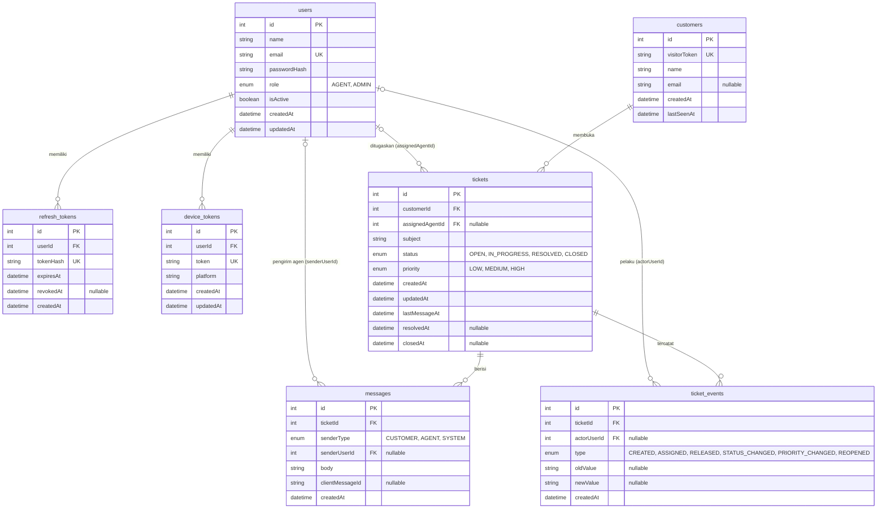

# ERD - Database Helpdesk

Database: PostgreSQL (dikelola dengan Prisma). Diagram di bawah menggambarkan 7 tabel utama.

## Catatan desain

- **Nomor tiket** (`HD-0001`) tidak disimpan. Nomor ditampilkan dari `tickets.id` dengan padding 4 digit.
- **Idempotensi pesan:** pasangan `(ticketId, clientMessageId)` bersifat unik, sehingga pengiriman ulang pesan yang sama dari klien tidak membuat baris ganda. Pesan sistem memakai `clientMessageId` kosong (NULL), yang diizinkan berulang oleh PostgreSQL.
- **Assignee** bersifat opsional: tiket berstatus `OPEN` belum memiliki `assignedAgentId`.
- **Audit trail:** setiap perubahan penting tiket (pembuatan, assign, release, status, prioritas, buka kembali) dicatat di `ticket_events` beserta nilai lama dan baru.
- **Index utama:** `tickets(status, assignedAgentId)`, `tickets(customerId, createdAt)`, `tickets(lastMessageAt)`, `messages(ticketId, id)`, `ticket_events(ticketId, createdAt)`.
- **Hapus berantai (cascade):** `refresh_tokens` dan `device_tokens` ikut terhapus bersama user; `messages` dan `ticket_events` ikut terhapus bersama tiketnya.
